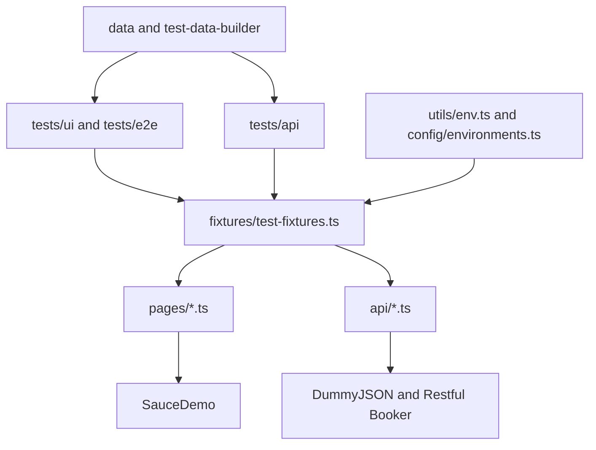
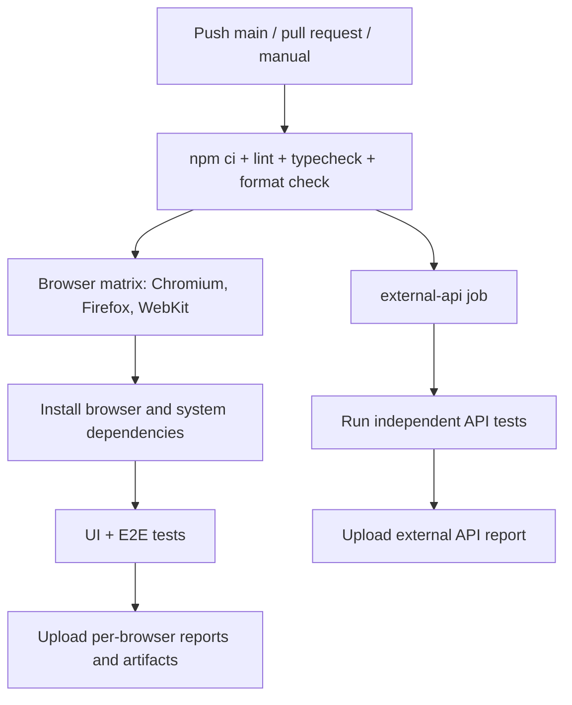

# CommerceGuard

A public portfolio framework for practicing maintainable UI and independent API automation with Playwright and strict TypeScript. It exercises the SauceDemo shopping journey and two unrelated public API sandboxes. No employer systems, customer accounts, or proprietary test assets are included.

## Features and stack

Playwright Test, TypeScript, Node.js 22+, npm, focused page objects, typed fixtures, data-driven validation, isolated browser contexts, APIRequestContext clients, cross-browser parallel execution, request interception, HTML reports, failure traces/screenshots/video, ESLint, Prettier, and GitHub Actions. Dependencies are resolved in package-lock.json; use npm ci for reproducibility.

## Architecture



Tests own business assertions. Page objects own locators and user actions. API clients return responses without hiding HTTP status or parsing errors. Each test gets a fresh browser context; API contexts are created only when their fixtures are requested, then disposed. Only the authenticated fixture asserts a readiness condition. Booking data is unique and only bookings created by the current test are deleted in finally cleanup.

## Repository structure

```text
commerceguard/
├── tests/
│   ├── ui/{login,login-validation,navigation,products,cart,checkout}.spec.ts
│   ├── api/{products,booking}.api.spec.ts
│   └── e2e/purchase-flow.spec.ts
├── pages/{LoginPage,ProductsPage,CartPage,CheckoutPage}.ts
├── api/{ProductsApi,BookingApi}.ts
├── fixtures/test-fixtures.ts
├── data/{users,products}.ts
├── utils/{env,test-data-builder}.ts
├── config/environments.ts
├── .github/workflows/playwright.yml
├── .env.example
├── .gitignore
├── .prettierignore
├── .prettierrc.json
├── eslint.config.js
├── package.json
├── package-lock.json
├── playwright.config.ts
├── tsconfig.json
├── README.md
├── CONTRIBUTING.md
├── VALIDATION.md
└── LICENSE
```

## Installation: Windows, macOS, Linux

Install Node.js 22.13+ (22 LTS recommended) and Git, then clone your published repository or extract this archive and open a terminal in commerceguard. Commands below work in PowerShell, Terminal, and Linux shells.

```sh
npm ci
npx playwright install --with-deps chromium firefox webkit
npm run lint
npm run typecheck
npm run format:check
```

On Windows/macOS Playwright installs the matching browsers; Linux may request administrator rights to install system libraries. Use a supported OS listed in the [Playwright installation documentation](https://playwright.dev/docs/intro). No global npm packages are needed. API-only execution needs no browser download.

Optional configuration: copy .env.example to .env (`Copy-Item .env.example .env` in PowerShell, `cp .env.example .env` on macOS/Linux). The Node built-in env loader loads it; existing shell variables take precedence. No dotenv dependency is required.

## Execution

| Command                | Scope                                             |
| ---------------------- | ------------------------------------------------- |
| `npm test`             | All UI/E2E browser projects and API project       |
| `npm run test:ui`      | UI specifications on Chromium, Firefox and WebKit |
| `npm run test:api`     | Independent external API checks, once             |
| `npm run test:e2e`     | Purchase journey on all three browsers            |
| `npm run test:headed`  | All suites, browser tests visible                 |
| `npm run test:debug`   | Chromium tests in Inspector                       |
| `npm run report`       | Open last HTML report                             |
| `npm run lint`         | ESLint                                            |
| `npm run typecheck`    | Strict TypeScript check                           |
| `npm run format`       | Apply Prettier                                    |
| `npm run format:check` | Check formatting without changing files           |

Run one browser or test:

```sh
npx playwright test --project=chromium
npx playwright test tests/ui/cart.spec.ts --project=chromium
npx playwright test --project=chromium --grep TC-023
npx playwright test --ui
```

Reports are generated automatically in playwright-report; per-test failure artifacts are in test-results. Open traces through the HTML report or `npx playwright show-trace test-results/<test-directory>/trace.zip` using an actual generated path. Use Inspector for locator/action debugging, traces for network and DOM snapshots, screenshots/video for visible state. Reports may contain test input: review before sharing. No result badges, timings, or performance claims are implied.

## Example: page action and business assertion

From pages/CartPage.ts:

```ts
async checkout(): Promise<void> {
  await this.page.getByRole('button', { name: 'Checkout', exact: true }).click();
}
```

From tests/ui/cart.spec.ts:

```ts
test('TC-018: Continue shopping returns to inventory', async ({
  authenticatedProducts: catalog,
  cartPage,
  page,
}) => {
  await catalog.cart();
  await cartPage.continueShopping();
  await expect(page).toHaveURL(/inventory.html$/);
  await expect(catalog.title).toHaveText('Products');
});
```

SauceDemo uses data-test attributes; playwright.config.ts configures getByTestId accordingly. Buttons use accessible roles. No fixed sleeps or shared login-state file are used.

## Browser and API coverage

| Suite             | Coverage                                                                                                | Execution                 |
| ----------------- | ------------------------------------------------------------------------------------------------------- | ------------------------- |
| UI authentication | Valid login; five invalid/missing-credential rows; masking; logout; protected inventory after logout    | Chromium, Firefox, WebKit |
| UI products       | Six configured products and prices; details; one/multiple additions; four sort modes; intercepted image | All three browsers        |
| UI cart           | Names/prices, badge changes, removal to empty, continue shopping                                        | All three browsers        |
| UI checkout       | Customer form entry, required fields                                                                    | All three browsers        |
| Purchase E2E      | Cart/overview identity, prices, subtotal, tax/total arithmetic, confirmation, cleared cart              | All three browsers        |
| DummyJSON         | Paginated list field/type checks; single product; unknown product 404                                   | API project               |
| Restful Booker    | Public demo auth; unique create/read/update/delete; unauthenticated update 403; invalid auth response   | API project               |

API URLs and documentation: [DummyJSON products](https://dummyjson.com/docs/products) and [Restful Booker](https://restful-booker.herokuapp.com/apidoc/index.html). There is no assumed SauceDemo public API. Product response checks are explicit partial structural contracts, not a claim of validating an official JSON Schema. Booking responses are checked against the full submitted typed payload. Invalid Booker credentials return HTTP 200 with a reason; this is checked deliberately rather than assuming 401.

TC-015 intercepts a real SauceDemo image request and fulfills a deterministic SVG response, then checks its decoded width. SauceDemo is a static client application, so this demonstrates network response mocking without inventing a backend endpoint. It is not a mocked commerce API or an API integration test.

## Configuration and test data

| Variable         | Default                              | Purpose                                |
| ---------------- | ------------------------------------ | -------------------------------------- |
| TEST_ENV         | demo                                 | Explicit supported environment profile |
| UI_BASE_URL      | https://www.saucedemo.com            | UI origin                              |
| PRODUCTS_API_URL | https://dummyjson.com                | Product API origin                     |
| BOOKING_API_URL  | https://restful-booker.herokuapp.com | Booking API origin                     |
| CI               | Set by GitHub Actions                | Two workers and forbidOnly             |

URLs must be HTTP(S) origins. To add another profile, update both config/environments.ts and the validation in utils/env.ts. Overrides must target a compatible sandbox with the same behavior. UI catalog expectations are in data/products.ts. Public demo credentials are in data/users.ts; Booker's published demo admin credentials are defaults in api/BookingApi.ts. These are sandbox fixtures, not real account secrets. Never add private credentials to code or .env.example.

## CI/CD



.github/workflows/playwright.yml runs quality checks first. Each browser job runs its own isolated UI/E2E suite. external-api runs separately so network outages can be distinguished from UI regressions. Artifacts are retained seven days and uploaded after failures too. Jobs fail normally: no continue-on-error, automatic skipping, or suppressed failures. Retries are zero locally and in CI to expose first-attempt defects. Browser parallelism is capped at two CI workers to limit public-service load; the matrix does not cancel siblings on failure.

## Limitations

Public sandboxes can change content, throttle requests, reset data, or become unavailable. Their uptime is outside this repository's control. Booker is a shared mutable service: unique names and owned-record cleanup reduce collisions but cannot prevent a service reset during a test. Cleanup failures fail the test and expose the affected ID. A response that cannot be parsed may prevent obtaining its created ID. Do not run high-volume/load tests against these services.

Catalog values and current SauceDemo selectors must be rechecked after upstream changes. Product totals are not hardcoded for DummyJSON. Sorting checks names/prices separately so equal-price product order is not over-specified. Checkout verifies displayed tax arithmetic, not a legal tax-rate rule. No payment processing, real order placement, performance, visual regression, accessibility audit, or production security coverage is claimed. There are no intentionally skipped tests. See VALIDATION.md for the actual checks performed in the build environment and any restrictions.

## Contributing and roadmap

Read CONTRIBUTING.md for local checks and PR conventions. Planned improvements: an owned local application/API for fully deterministic CI; official schema validation if a versioned schema becomes available; accessibility checks; tagged smoke selection; and scheduled low-frequency sandbox health checks. These are future work, not implemented features.

## GitHub repository

Source: [rahulbiswas12/CommerceGuard](https://github.com/rahulbiswas12/CommerceGuard).

```sh
git clone https://github.com/rahulbiswas12/CommerceGuard.git
cd CommerceGuard
npm ci
npx playwright install --with-deps chromium firefox webkit
npm test
```

Review the [Actions runs](https://github.com/rahulbiswas12/CommerceGuard/actions) and their reports after each push. The validation record describes the checks actually completed during initial framework creation; it does not claim a successful CI run.

## License and independence

Framework code is MIT licensed. This independent portfolio project is not affiliated with, endorsed by, or developed for Sauce Labs or Ericsson. SauceDemo and the API sandboxes, their content, trademarks and source remain the property of their respective owners. The MIT license applies only to this repository's original framework code.
